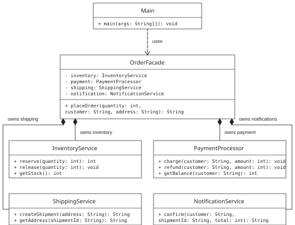

# Facade Pattern — Online Order Processing

A simple Java 17 learning example. `Main` uses only `OrderFacade`,
which coordinates inventory, payment, shipping, and notification.

Repository: https://github.com/bigstep832/assignment-4-facade-pattern

There is one product: Java Book, priced at 1000 KZT. The initial stock is 3 books.
Alice's demo balance is 3000 KZT, and Bob's demo balance is 500 KZT.
All operations are simulated in memory: no real payments, shipments, or messages are sent.

## Open and run in VS Code

You need JDK 17 or newer. On this Windows computer, the tasks use the installed
JDK at `C:\Program Files\Java\jdk-21.0.10`. If your JDK is installed elsewhere,
update the `windows.command` paths in `.vscode/tasks.json`. On macOS and Linux,
the tasks use `java` and `javac` from PATH.
Open the whole `facade-order` folder in VS Code using **File > Open Folder**.

Choose **Terminal > Run Task**, then select:

- **Run demo** — compiles the source files and runs the five examples.
- **Run tests** — compiles the source files and tests, then runs all ten tests.
- **Compile Java** — compiles the program without running it.

You can also press **Ctrl+Shift+B** to compile. The compiled files go into `out/`.
The project recommends the optional **Extension Pack for Java** for editor support.
The tasks work with the JDK alone, and no extension is installed automatically.

## Run from a terminal

You need JDK 17 or newer. Run these commands from the project folder:

```text
javac --release 17 -encoding UTF-8 -d out src/*.java
java -cp out Main
```

## Project structure

- `src/Main.java` — client and demonstration.
- `src/OrderFacade.java` — simple interface for placing an order.
- `src/InventoryService.java` — reserves and releases books.
- `src/PaymentProcessor.java` — charges and refunds demo accounts.
- `src/ShippingService.java` — creates and stores shipments.
- `src/NotificationService.java` — creates and stores confirmations.
- `test/OrderFacadeTest.java` — tests without third-party libraries.
- `.vscode/` — compile, run, and test tasks, plus an optional extension recommendation.
- `docs/Facade_Report.pdf` — English report with UML, five Clean Code principles, and code screenshots.
- `docs/uml.svg` — class diagram.
- `docs/screenshots/` — VS Code screenshots of the complete source code.
- `DEFENSE_EN.txt` — short notes for the in-class defense.



## Run the tests

```text
javac --release 17 -encoding UTF-8 -d out src/*.java test/*.java
java -cp out OrderFacadeTest
```

Verified using JDK 21 with Java 17 as the compilation target (`--release 17`).
Result: `All 10 tests passed.` The demonstration shows a successful order,
a declined payment, a shipping error with a refund, a purchase after rollback,
and a rejected order when stock is empty.

